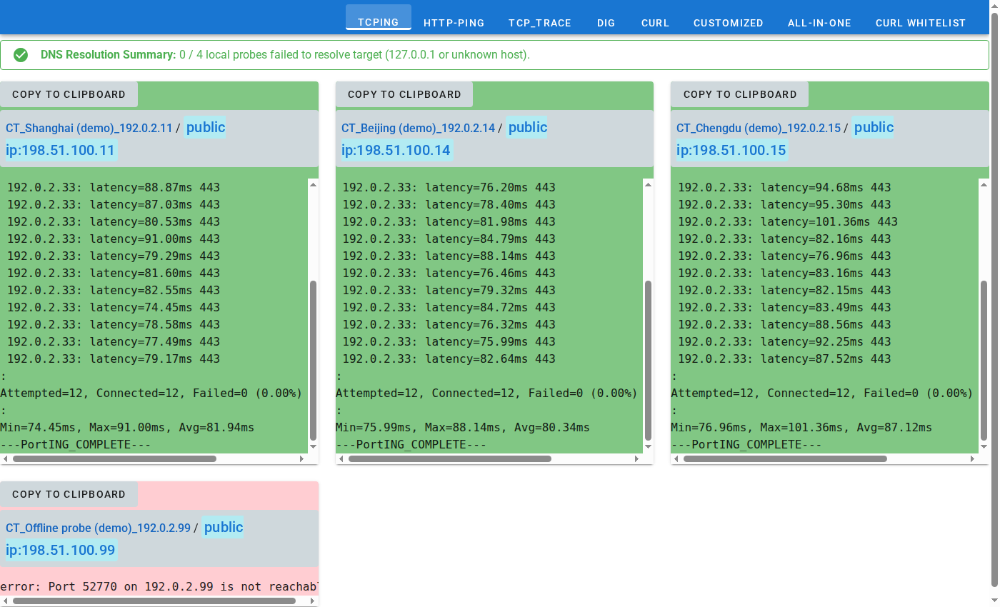
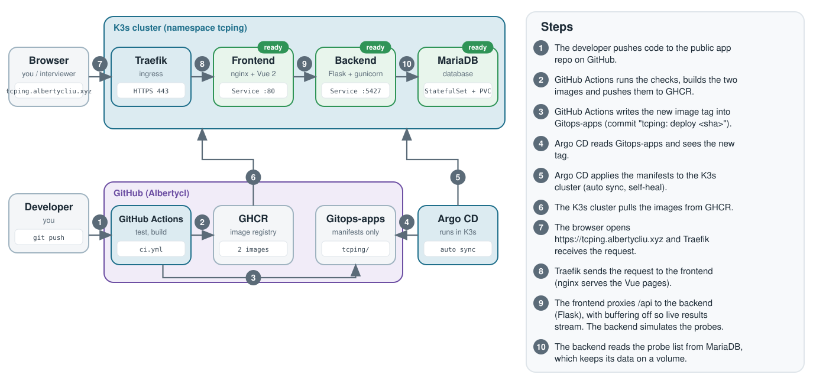

# Tcping

**Live demo:** https://tcping.albertycliu.xyz (made-up probes, no login)

A web tool that checks from many places whether a host is reachable: pick probe servers in different countries and ISPs, pick a target, and watch the results appear live.



## What it does

- Runs TCP ping, MTR / traceroute, dig, curl, HTTP ping and custom commands from a chosen group of probes at the same time.
- Streams the output to the browser while the commands run.
- The probes are simulated (the real servers no longer exist). Put `down`, `timeout`, `flaky`, `slow` or `nxdomain` in the target name to see how failures look.

## How it works



Code goes to GitHub, GitHub Actions builds the images and updates the [Gitops-apps](https://github.com/Albertycl/Gitops-apps) repo, and Argo CD deploys the change to a K3s cluster by itself.

## SRE skills this shows

- **GitOps and CI/CD:** GitHub Actions, GHCR, Argo CD with auto sync and self-heal.
- **Rollback:** `git revert` of the "tcping: deploy" commit in Gitops-apps.
- **Containers:** multi-stage frontend build, Docker Compose with a database health check.
- **Configuration:** the database password comes from an environment variable or a Kubernetes Secret, never from Git.
- **Kubernetes:** StatefulSet with a volume, Traefik ingress with a Let's Encrypt certificate, readiness probes (health checks), resource requests and limits.
- **Streaming and tracing:** nginx proxy with buffering off so live output works, and OpenTelemetry tracing set up in the cluster.

## Run it locally

Needs Docker with the Compose plugin.

```bash
cp .env.example .env     # set MYSQL_APP_PASSWORD (any value without special characters)
docker compose -f docker-compose.standalone.yml up --build
```

Then open `http://localhost:5435`. The database loads the demo data on its first start.

## More

[Full details](docs/DETAILS.md): install on Kubernetes, CI/CD, monitoring and known limits.
